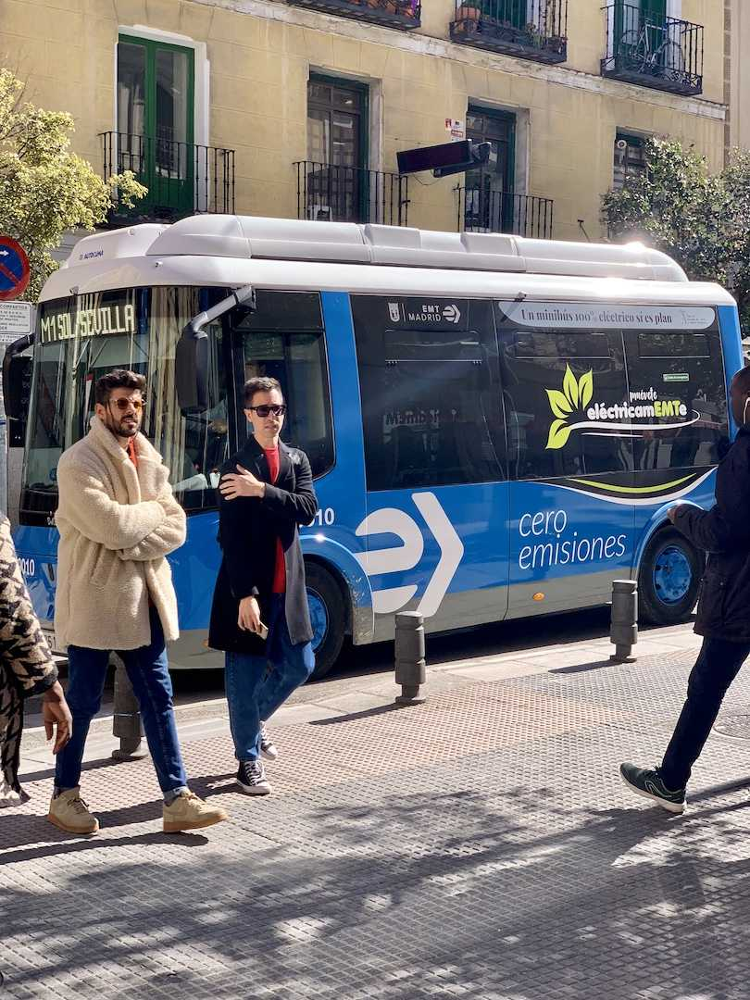
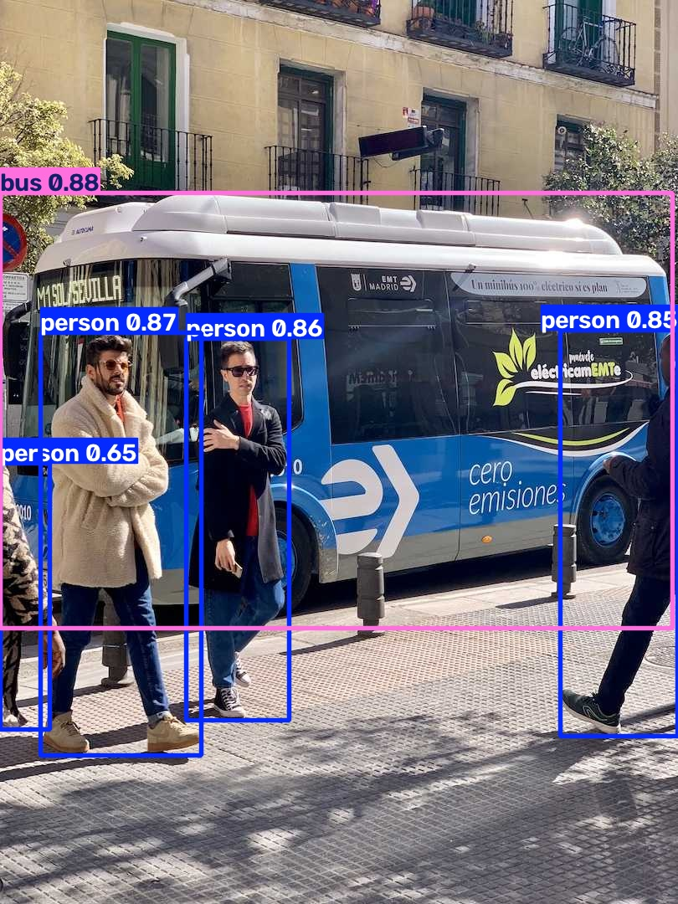

# visionai-test

**YOLO26n Object Detection — Image & Video Inference Demo**

Repository minh họa khả năng chạy thử **Ultralytics YOLO26n pretrained** trên **ASUS Ascent GX10 (NVIDIA GB10, ARM64, CUDA 13.0)**. Dự án sử dụng các thành phần mã nguồn mở phổ biến: PyTorch, Ultralytics và OpenCV.

> **Phạm vi:** Chạy suy luận trên ảnh/video, xuất bounding box và thống kê cơ bản. **Chưa fine-tune mô hình và chưa đánh giá mAP**. Đây không phải mô hình đã huấn luyện riêng cho giao thông Việt Nam.

## Hình ảnh minh họa

| Ảnh đầu vào | YOLO26n — Bounding Boxes |
|:---:|:---:|
|  |  |

*Ảnh thử nghiệm từ tài nguyên ví dụ của Ultralytics; kết quả chạy trên NVIDIA GB10. Xem [nguồn và giấy phép ảnh](assets/ATTRIBUTION.md). Không có dữ liệu CCTV VN2V-Weather trong repository.*

## Kết quả chạy thử đã xác minh

| Hạng mục | Kết quả |
|---|---|
| Model | `YOLO26n` pretrained, COCO classes |
| Thiết bị | ASUS Ascent GX10, NVIDIA GB10, Linux ARM64 |
| PyTorch | `2.14.1+cu130` |
| Ultralytics | `8.4.211` |
| Test ảnh | 1 bus, 4 person (ảnh mẫu Ultralytics) |
| GPU | NVIDIA GB10, CUDA 13.0 |
| Test video công khai (không kèm file) | 300 frames, Full HD, 10,01 s |
| Tốc độ pipeline video đã đo | 50,91 FPS, khoảng 3,838 ms suy luận/frame |
| Kết quả đánh giá độ chính xác | **Chưa thực hiện** |

**Chú ý:** FPS và ms trên là số đo của một lần thử với phần cứng và video cụ thể; không khẳng định hiệu năng cố định. Kết quả pretrained không phải checkpoint đã fine-tune. Đếm bounding box theo từng frame **không phải** đếm số xe duy nhất.

## Cấu trúc repository

```text
visionai-test/
├── README.md
├── requirements.txt
├── .gitignore
├── scripts/
│   ├── predict_image.py        # Suy luận ảnh và lưu JSON
│   └── predict_video.py        # Suy luận video/RTSP, xuất MP4 + JSON
└── assets/
    ├── example_input.jpg
    ├── example_prediction.jpg
    └── ATTRIBUTION.md
```

Không có datasets, token, pretrained weights, camera RTSP URL hay video nội bộ trong GitHub.

## 1. Cài đặt (ASUS Ascent GX10)

Khuyến nghị Python 3.11+ và sử dụng môi trường ảo.

```bash
git clone https://github.com/teenevin28/visionai-test.git
cd visionai-test
python3 -m venv .venv
source .venv/bin/activate
```

Trên **ARM64 + NVIDIA GB10 / CUDA 13.0**, sử dụng PyTorch wheel phù hợp:

```bash
python -m pip install \
  'torch==2.14.1+cu130' 'torchvision==0.29.1+cu130' \
  --index-url https://download.pytorch.org/whl/cu130
python -m pip install -r requirements.txt
```

Các máy có CUDA/OS khác cần chọn PyTorch tương ứng theo tài liệu chính thức: https://pytorch.org/get-started/locally/ . Không cài nhầm wheel x86 lên ARM64.

Kiểm tra GPU:

```bash
python -c 'import torch; print(torch.__version__, torch.cuda.is_available()); print(torch.cuda.get_device_name(0) if torch.cuda.is_available() else "CPU")'
```

## 2. Chạy thử trên ảnh

Ảnh demo đã nằm trong `assets/`:

```bash
python scripts/predict_image.py \
  --source assets/example_input.jpg \
  --weights yolo26n.pt \
  --device auto \
  --output outputs/prediction.jpg
```

Ở lần chạy đầu, Ultralytics có thể tải checkpoint `yolo26n.pt` từ nguồn chính thức. `outputs/` và `*.pt` được loại khỏi Git.

Đầu ra:
- `outputs/prediction.jpg` — ảnh có bounding box.
- `outputs/prediction.json` — confidence, tọa độ, thời gian suy luận, thông tin GPU.

Nếu đã có trọng số tại vị trí riêng:

```bash
python scripts/predict_image.py --source assets/example_input.jpg --weights /path/to/yolo26n.pt
```

## 3. Chạy thử video ngắn / luồng camera

Chuẩn bị video MP4 **có quyền sử dụng**, sau đó:

```bash
python scripts/predict_video.py \
  --source /path/to/your_traffic_video.mp4 \
  --weights yolo26n.pt \
  --seconds 10 \
  --imgsz 640 \
  --device auto \
  --output outputs/vehicle_detection.mp4
```

Chỉ hiển thị bốn lớp phương tiện COCO: `car`, `motorcycle`, `bus`, `truck`. Video kết quả và tệp JSON được lưu trong `outputs/`. Có thể thay `--source` bằng đường dẫn RTSP do bạn quản lý hoặc camera index, không ghi địa chỉ nội bộ vào Git.

## Nguồn mở và lưu ý bản quyền

- Ultralytics: https://github.com/ultralytics/ultralytics (AGPL-3.0 hoặc giấy phép thương mại).
- PyTorch: https://github.com/pytorch/pytorch
- OpenCV: https://github.com/opencv/opencv
- Ảnh ví dụ Ultralytics: [ATTRIBUTION.md](assets/ATTRIBUTION.md).

Mã công cụ ở đây là ví dụ thực nghiệm độc lập; không tích hợp hay phân phối lại nguyên bộ mã Ultralytics, pretrained weights hoặc dữ liệu giám sát. **Giấy phép dành cho phần mã nguồn riêng của repository chưa được lựa chọn**; quyền sử dụng các phụ thuộc và ảnh mẫu tuân theo giấy phép tương ứng.
